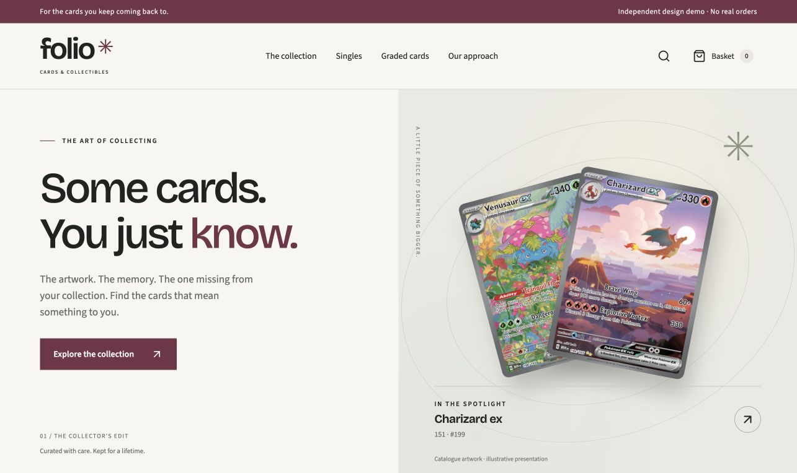
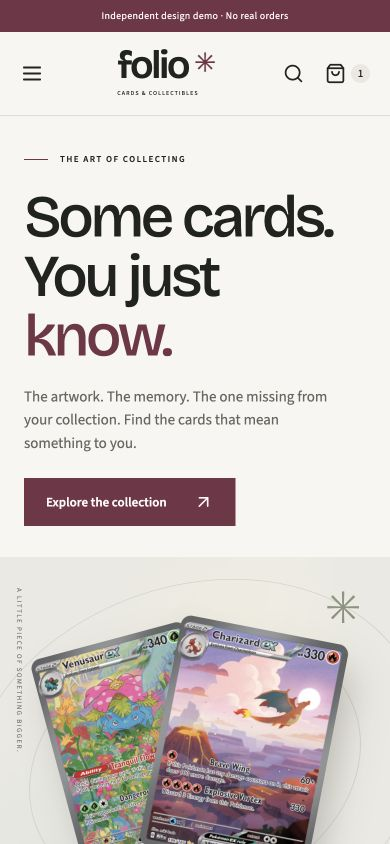

# Folio Cards · Love Yours Media

[Explore the interactive storefront concept](https://preview--folio-cards-lym.netlify.app/) · [LYM design examples](https://loveyoursmedia.com/examples/)

A premium collector’s shop concept: light surfaces, expressive typography, careful product presentation and restrained holographic detail.

## Explore

- A designed homepage and searchable collection with mobile filters.
- Single-card listings with condition, language, prices and separate variant stock caps.
- Illustrative graded listings with an image gallery and grading detail fields.
- A browser-local basket and demonstration order summary.

This is LYM-authored design and application work, not a client commission or an operating retailer. Prices, inventory, grades and delivery are illustrative. No orders or payments are accepted. Graded images are illustrative, not photographs of a certified specimen.

The underlying source, configurable branding and catalogue system are held in a private LYM repository. This public repository presents the design only; it does not grant reuse rights or expose operational configuration.

## Rights

Original layout, styling, application and original graphics: © 2026 Love Yours Media / Love Yours Recordings Ltd, all rights reserved. Pokémon artwork belongs to its respective rights holders and appears as reference imagery sourced via TCGdex. Commercial clearance has not been established. Merchant-authorised product photographs must replace these references for a commercial store. Font software retains its respective OFL licences. No affiliation with Pokémon or a grading company is claimed.

## Verification scope

The demonstration was checked in Chrome for catalogue search, sorting, mobile filter application/reset, variant selection, stock caps, graded single-stock limits, basket persistence and image enlargement. Direct Netlify routes and asset integrity were checked. This is not evidence of live payments, Shopify administration, commercial outcomes, a full accessibility audit or physical-device compatibility.

